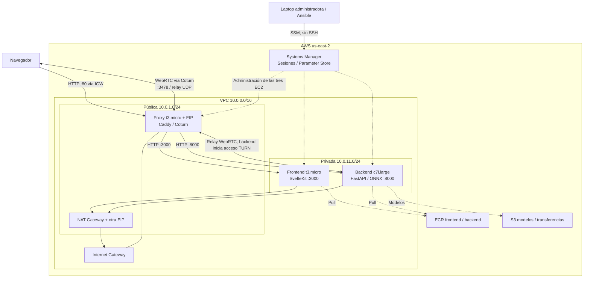

# Arquitectura actual de Polyp Detection en staging

Documento basado en el código y la configuración del repositorio revisados el 12 de noviembre de 2026, incluidos los cambios locales existentes. Describe la arquitectura **configurada**; no certifica que todos los recursos estén actualmente desplegados en AWS. No se consultaron servicios AWS, valores secretos ni estados o planes de Terraform.

# 1. Resumen ejecutivo

Polyp Detection es una aplicación web experimental de apoyo a la visualización y detección de pólipos en video. El frontend SvelteKit permite preparar una cámara del navegador o un archivo local, iniciar una sesión y visualizar la fuente original o el video procesado. Un backend FastAPI recibe video mediante WebRTC, ejecuta detección y clasificación con ONNX Runtime sobre CPU y devuelve una pista con cajas y etiquetas. La implementación del detector se identifica como YOLO26s y la del clasificador como ConvNeXt-Tiny; sus etiquetas son `adenoma` e `hiperplasico`. Estas son salidas del modelo, no diagnósticos clínicos validados.

El despliegue de staging se configura en AWS con tres instancias EC2: un proxy público con Caddy y Coturn, un frontend privado y un backend privado. Terraform define los recursos y Ansible instala y despliega los contenedores mediante AWS Systems Manager, sin SSH. El sistema es un prototipo de investigación: **no realiza diagnóstico autónomo, no sustituye el criterio clínico y no debe usarse como herramienta de diagnóstico clínico**.

# 2. Topología actual de AWS

Los valores siguientes proceden de `infra/terraform/environments/staging/terraform.tfvars`, `network.tf`, `compute.tf` y los recursos asociados.

| Elemento | Configuración verificada |
| --- | --- |
| Región | `us-east-2` |
| Proyecto / entorno | `polyp` / `staging`; prefijo `polyp-staging` |
| VPC | `polyp-staging-vpc`, CIDR `10.0.0.0/16`, DNS habilitado |
| Subred pública | `polyp-staging-public`, `10.0.1.0/24` |
| Subred privada | `polyp-staging-private`, `10.0.11.0/24` |
| Zona de disponibilidad | Ambas subredes usan `data.aws_availability_zones.available.names[0]`; no hay una zona literal fijada |
| Internet Gateway | Uno, asociado a la VPC; ruta pública `0.0.0.0/0` hacia él |
| NAT Gateway | Uno, en la subred pública, con su propia EIP; ruta privada `0.0.0.0/0` hacia él |
| EIP del proxy | Una EIP adicional asociada a la instancia proxy; output `proxy_public_ip` |

Hay **tres instancias**, una por rol, con Amazon Linux 2023 x86_64 obtenido mediante el parámetro público de AMI de AWS:

| Instancia / tag `Role` | Subred / tipo | Función y almacenamiento raíz |
| --- | --- | --- |
| `polyp-staging-proxy` / `proxy` | Pública / `t3.micro` | Caddy (`polyp-proxy`) y Coturn (`polyp-turn`), en contenedores separados; EBS gp3 de 20 GiB |
| `polyp-staging-frontend` / `frontend` | Privada / `t3.micro` | SvelteKit con adaptador Node, contenedor `polyp-frontend`; EBS gp3 de 20 GiB |
| `polyp-staging-backend` / `backend` | Privada / **`c7i.large`** | FastAPI, aiortc y ONNX Runtime sobre CPU, contenedor `polyp-backend`; EBS gp3 de 40 GiB |

Los volúmenes raíz están cifrados y configurados para borrarse al terminar su instancia. Frontend y backend tienen `associate_public_ip_address = false`. El proxy tiene IP pública habilitada y una asociación explícita a EIP.

| Servicio auxiliar | Configuración y propósito |
| --- | --- |
| ECR | Repositorios privados `polyp-staging-frontend` y `polyp-staging-backend`; tags inmutables y escaneo al publicar. Política: expirar imágenes sin tag después de 7 días y conservar las 10 imágenes etiquetadas más recientes |
| S3 de modelos | Nombre calculado `polyp-staging-models-<cuenta>-us-east-2`; almacena los artefactos `detector.onnx` y `classifier.onnx`, que se cargan por separado de Terraform |
| S3 de transferencia | `polyp-staging-ansible-transfer-<cuenta>-us-east-2`; módulos y archivos temporales de la conexión Ansible/SSM; expiración configurada de 1 día y versionado suspendido |
| Parameter Store | SecureString Standard `/polyp/staging/turn/shared-secret`; secreto TURN generado por Terraform, de 64 caracteres alfanuméricos, sin output de su valor |
| S3 de estado Terraform | Definido en `infra/terraform/bootstrap/`: `polyp-terraform-state-<cuenta>-us-east-2`, cifrado AES256, versionado, bloqueo público y `prevent_destroy = true` |

Los buckets de modelos y transferencia tienen bloqueo público, cifrado AES256, propiedad `BucketOwnerEnforced` y política que deniega transporte no seguro. El bucket de modelos tiene versionado habilitado. Ninguno se utiliza en el código revisado como almacén de videos clínicos.



El diagrama agrupa los servicios administrados fuera de las subredes. Las conexiones de las EC2 privadas hacia sus endpoints públicos salen por NAT e Internet Gateway; no se definen VPC endpoints en el Terraform revisado.

**Runtime, costes y persistencia.** Las tres EC2 y sus EBS, el NAT Gateway y las direcciones IPv4 públicas/EIP son recursos de ejecución con coste; también puede haber cargos por transferencia y procesamiento de tráfico. ECR y S3 conservan artefactos y pueden seguir generando costes de almacenamiento y solicitudes aunque se retire la ejecución. No se calculan precios en este documento.

Hay una distinción importante: **staging no está separado en estados de Terraform de runtime y persistencia**. EC2, red, EIP, ECR, buckets de modelos/transferencia, IAM y parámetro TURN pertenecen al mismo directorio de staging. Si se retiran solamente los recursos de ejecución conservando el resto, los artefactos y el parámetro permanecen. Un `terraform destroy` completo de staging también intentaría eliminar estos recursos: no tienen `prevent_destroy`; buckets o repositorios con contenido pueden impedir que termine la eliminación. Ese fallo no constituye una política de conservación. El bucket del estado pertenece al bootstrap separado y sí tiene protección explícita. No hay un procedimiento automatizado de destrucción exclusiva del runtime en los archivos revisados.

Al destruir también la EIP del proxy se libera su dirección; al recrearla se asigna otra y **no se garantiza recuperar la anterior**. Si se conserva el recurso EIP, esta puede mantenerse al reemplazar una EC2. El origen público compilado en frontend y la configuración TURN deben corresponder a la EIP vigente.

# 3. Protocolos, puertos y comunicaciones

Los puertos de la tabla son de destino; los puertos de origen y los candidatos ICE pueden ser dinámicos. Las conexiones a servicios AWS usan sus endpoints HTTPS, no puertos de entrada adicionales en las EC2.

| Origen → destino | Protocolo / puerto de destino | Clase y comportamiento comprobado |
| --- | --- | --- |
| Navegador → proxy/Caddy | HTTP, TCP **80** | Público. Sitio web y señalización API sobre el mismo proxy |
| Navegador → proxy/Coturn | STUN/TURN, TCP y UDP **3478** | Público. Coturn admite ambos transportes; `POLYP_TURN_URL` selecciona `transport=udp` o `transport=tcp` |
| Peers WebRTC ↔ relay Coturn | Media WebRTC/SRTP, UDP **49160–49200** en proxy | Público en la EIP del proxy. Rango de asignaciones relay, distinto del puerto de escucha 3478. `no-tcp-relay` deshabilita relay TCP, aunque el cliente TURN pueda usar TCP 3478 |
| Proxy/Caddy → frontend | HTTP, TCP **3000** | Privado, por IP privada; ingreso autorizado desde el SG proxy |
| Proxy/Caddy → backend | HTTP, TCP **8000** | Privado. `handle_path /api/*` quita `/api` antes de reenviar |
| Navegador → backend, vía Caddy | HTTP público TCP **80** y HTTP privado TCP **8000** | `GET /api/webrtc/ice-servers` y `POST /api/webrtc/offer` se convierten en `/webrtc/ice-servers` y `/webrtc/offer` en FastAPI |
| Navegador ↔ backend, conexión lógica | WebRTC: ICE, negociación DTLS y medios SRTP; puertos seleccionados por ICE | Los medios no pasan por las rutas HTTP de Caddy. En staging se apoyan en Coturn: no hay rango público WebRTC abierto en el backend |
| Backend → Coturn | TURN TCP o UDP **3478**, según `TURN_URL` | Backend privado inicia conexión hacia la EIP configurada; su salida pública pasa por NAT. Las respuestas dependen del seguimiento de conexiones del SG; no hay regla privada adicional de entrada para media |
| Backend y proxy → SSM Parameter Store | HTTPS, TCP **443** | Administración durante despliegue. AWS CLI remoto ejecuta `get-parameter --with-decryption` con IAM de la EC2 |
| Backend → S3 de modelos | HTTPS, TCP **443** | Despliegue. `aws s3 sync` descarga únicamente los dos nombres ONNX; después se leen desde disco local |
| EC2 frontend/backend → ECR y capas de imágenes | HTTPS, TCP **443** | Despliegue. Autenticación temporal ECR y `docker pull`; la descarga de capas también requiere acceso a S3 |
| Proxy → registro de imágenes | HTTPS, TCP **443** | Despliegue. Caddy y Coturn se descargan de Docker Hub, no de los dos repositorios ECR definidos |
| Laptop administradora → Systems Manager | API HTTPS y canal de sesión seguro, TCP **443** | Administrativo. Ansible usa `amazon.aws.aws_ssm` y Session Manager Plugin; no SSH/TCP 22 |
| Agente SSM de las tres EC2 → Systems Manager | HTTPS/canales seguros, TCP **443** de salida | Administrativo. La sesión usa el agente SSM; las privadas necesitan salida por NAT |
| Controlador Ansible y EC2 ↔ S3 de transferencia | HTTPS, TCP **443** | Administrativo. Intercambio temporal de módulos/archivos mediante el bucket dedicado; distinto del bucket de modelos |

**Señalización y medios son dos intercambios diferentes.** El `POST /webrtc/offer` lleva JSON con `sdp` y `type`; la respuesta contiene el SDP de respuesta. SDP describe medios, códecs y candidatos de conectividad. ICE reúne candidatos y prueba pares para encontrar una ruta; STUN permite comprobar conectividad y conocer direcciones vistas desde otra red. TURN asigna un relay que retransmite paquetes cuando no hay una ruta directa utilizable. La implementación intercambia candidatos reunidos en SDP: espera a completar ICE antes de enviar oferta/respuesta, sin un endpoint adicional de trickle ICE ni señalización WebSocket.

En la configuración actual, el backend está en una subred privada y su SG solo permite TCP 8000 desde el proxy. Por tanto, una ruta directa navegador–backend **no debe darse por disponible**: TURN es parte necesaria del diseño de media en staging. El endpoint ICE devuelve una URL TURN configurada, no una lista fija de servidores STUN externos; Coturn también responde STUN. El código no impone `iceTransportPolicy: 'relay'`: la elección concreta la realiza ICE y debe comprobarse durante una prueba real.

Caddy tiene `auto_https off`, escucha `:80` y Docker publica `80:80`. El SG permite TCP 443, pero **eso no implementa HTTPS**. El acceso público actual es HTTP sin TLS. La cámara del navegador requiere un contexto seguro, normalmente HTTPS fuera de localhost; el propio frontend muestra ese requisito. Un archivo local permite probar el flujo sin acceso a cámara, sujeto al soporte del navegador. El cifrado DTLS-SRTP de WebRTC no protege por sí solo la página HTTP ni la entrega de credenciales y SDP. Coturn está configurado sin TLS/DTLS de transporte TURN; no se configura servicio TURN en 5349.

# 4. Flujo principal del aplicativo

1. **Abrir el sitio.** El usuario accede por HTTP a la EIP del proxy. El navegador carga la interfaz SvelteKit y sus recursos a través de Caddy.
2. **Resolver rutas.** Caddy reenvía las rutas del sitio al frontend privado en 3000. Las solicitudes `/api/*` se reenvían al backend privado en 8000 eliminando el prefijo; se trata de proxy inverso, no de una redirección HTTP al cliente.
3. **Preparar la fuente.** En `/sessions/new`, `ProcedureWorkspace.svelte` permite cámara o archivo. Cámara usa `getUserMedia`, sin audio, con preferencias de 768 × 576 y 24 FPS, no garantías de captura. Archivo usa una URL local, reproducción en bucle y dibujo a canvas; `canvas.captureStream(24)` produce la pista. El archivo no se sube mediante una API de archivos: se transmite el video capturado por WebRTC.
4. **Solicitar ICE.** Al iniciar asistencia, el frontend consulta `GET /api/webrtc/ice-servers` con `cache: 'no-store'`. FastAPI responde también `Cache-Control: no-store`. Si TURN está configurado, genera usuario y credencial efímeros; su TTL predeterminado es 3600 segundos. El secreto compartido no se devuelve. Sin URL o secreto, el backend devuelve `iceServers: []`, alternativa local que no demuestra conectividad de staging.
5. **Enviar la oferta.** El navegador crea `RTCPeerConnection`, añade la pista y genera una oferta SDP. Espera a completar la recolección ICE y envía `{sdp, type}` por `POST /api/webrtc/offer`, recibido como `POST /webrtc/offer` en FastAPI.
6. **Preparar recepción e inferencia.** El backend crea su peer con una identidad TURN efímera independiente y un transceptor de video `sendrecv`. Carga el pipeline ONNX de forma diferida en la primera oferta y lo reutiliza. Aplica la descripción remota, asocia la pista recibida a `VideoInferenceTrack`, crea la respuesta SDP y espera ICE antes de devolverla. El codec preferido por defecto es H.264, configurable a VP8; el objetivo inicial H.264 predeterminado es 2,5 Mbit/s con adaptación habilitada, no una tasa constante garantizada.
7. **Establecer la ruta.** El navegador aplica el SDP de respuesta y los peers prueban conectividad ICE. STUN ayuda a comprobar candidatos; TURN aporta relay si la ruta directa no funciona. En esta topología el backend privado depende de TURN y de su salida por NAT. Coturn usa red host en el proxy y publica la correspondencia EIP/IP privada; no añade un segundo NAT de Docker a TURN.
8. **Procesar y devolver video.** El pipeline detecta cajas con umbral 0,25, extrae recortes con margen 0,15 y clasifica con ONNX Runtime en CPU. La pista WebRTC separa recepción, inferencia y salida: procesa el fotograma más reciente, conserva predicciones hasta 0,35 segundos y las dibuja sobre fotogramas de salida posteriores. No hay seguimiento de objetos. La pista conserva las marcas temporales de la fuente y devuelve video anotado por WebRTC; esto no garantiza procesar o enviar todos los fotogramas.
9. **Visualizar estados.** El navegador recibe la pista con `ontrack`, la reproduce y muestra estados de conexión e ICE. Permite alternar visualización original/anotada. Ante fallo o desconexión avisa que la imagen anotada puede estar detenida y cambia a la original. Los registros de sesión son estado en memoria del frontend; el código revisado no los guarda en una base de datos ni implementa archivo persistente de video.
10. **Pausar o finalizar.** Pausar asistencia cierra el peer del navegador y conserva la fuente original. Finalizar detiene pistas locales, cancela animación y solicitudes, libera la URL del archivo y actualiza el registro de sesión. En backend hay limpieza al terminar la pista, fallar/cerrarse la conexión y apagar FastAPI: detiene tareas, cierra peers y elimina referencias de sesión. No existe una llamada HTTP específica de cierre ni se garantiza limpieza remota instantánea ante una pérdida abrupta de red. El pipeline compartido se conserva para reutilizar modelos durante la vida del proceso.

```mermaid
sequenceDiagram
    actor U as Usuario
    participant N as Navegador / frontend
    participant C as Caddy público
    participant F as SvelteKit privado
    participant B as FastAPI / aiortc
    participant T as Coturn público
    participant M as Pipeline ONNX CPU
    U->>N: Abrir sitio
    N->>C: GET / (HTTP 80)
    C->>F: HTTP 3000
    F-->>N: Interfaz vía Caddy
    U->>N: Preparar cámara o archivo e iniciar
    N->>C: GET /api/webrtc/ice-servers
    C->>B: GET /webrtc/ice-servers (8000)
    B-->>N: URL TURN y credenciales efímeras vía Caddy
    N->>T: Recolección ICE / TURN
    N->>N: Crear oferta y completar recolección ICE
    N->>C: POST /api/webrtc/offer {sdp, type}
    C->>B: POST /webrtc/offer
    B->>M: Cargar modelos si todavía no están cargados
    B->>B: Aplicar oferta y asociar pista procesada
    B->>T: ICE / TURN con identidad propia
    B-->>N: Respuesta SDP vía Caddy
    N->>N: Aplicar respuesta SDP
    Note over N,T: ICE selecciona ruta; staging depende de relay TURN
    loop Video activo
        N->>T: Media WebRTC protegida
        T->>B: Retransmitir media
        B->>M: Inferir sobre último fotograma disponible
        M-->>B: Cajas y clasificación
        B->>T: Pista de salida con anotaciones recientes
        T->>N: Media WebRTC protegida
        N->>N: Reproducir y mostrar estados
    end
    U->>N: Pausar o finalizar
    N->>N: Cerrar peer; finalizar también libera fuente
    Note over B: Limpieza al finalizar pista o fallar/cerrarse peer
```

El diagrama muestra la ruta con relay prevista para staging; no representa una medición de la ruta ni del rendimiento actualmente desplegados.

# 5. Flujo de despliegue

El proceso está definido por Terraform, Dockerfiles, inventario y roles Ansible. Los siguientes pasos describen su reproducción; documentarlos no ejecuta ningún despliegue.

1. **Preparar infraestructura con Terraform.** El bootstrap define el bucket del estado. Staging utiliza un backend S3 cuyos parámetros se proporcionan al inicializar; `versions.tf` no fija bucket ni clave. Inicializar con esa configuración, revisar el plan y aplicar crea red, IAM, ECR, buckets, parámetro TURN y EC2. Los modelos ONNX se cargan por separado en la raíz del bucket de modelos.
2. **Preparar variables de despliegue.** Configurar credenciales del controlador fuera de Git y `AWS_REGION=us-east-2`. Obtener outputs no sensibles: URLs ECR, bucket de modelos, bucket de transferencia, nombre del parámetro y EIP. Exportar `POLYP_BACKEND_IMAGE`, `POLYP_FRONTEND_IMAGE`, `POLYP_MODEL_BUCKET`, `ANSIBLE_SSM_BUCKET`, `POLYP_PUBLIC_ORIGIN`, `POLYP_TURN_PARAMETER_NAME`, `POLYP_TURN_URL`, `POLYP_PROXY_PUBLIC_IP` y `POLYP_PROXY_PRIVATE_IP`. El origen actual es `http://<EIP>`; TURN admite `turn:<EIP>:3478?transport=udp` o `transport=tcp`. La IP privada del proxy debe coincidir con el inventario.
3. **Construir imágenes desde la raíz.** Elegir tags explícitos nuevos porque ECR es inmutable. Compilar frontend con la URL pública de API; al importar `$env/static/public`, esa URL queda incorporada al build.

   ```sh
   docker build --build-arg PUBLIC_API_URL="${POLYP_PUBLIC_ORIGIN}/api" -t "$POLYP_FRONTEND_IMAGE" frontend/
   docker build -t "$POLYP_BACKEND_IMAGE" backend/
   ```

4. **Publicar en ECR.** Autenticarse en el registro de las URI elegidas con `aws ecr get-login-password` y `docker login --password-stdin`, y publicar ambas imágenes con `docker push`. Ansible no construye ni publica imágenes. La CI de `.github/workflows/ci.yml` comprueba y compila frontend; no implementa un pipeline de publicación ECR o despliegue AWS.
5. **Descubrir y validar instancias.** Desde `infra/ansible`, el inventario `amazon.aws.aws_ec2` filtra EC2 en ejecución con tags `Project=polyp`, `Environment=staging`, en `us-east-2`, y agrupa por `ec2_tags.Role`. El preflight exige exactamente tres EC2 distintas, una por rol, transporte SSM, variables válidas y direcciones privadas disponibles.
6. **Conectar por SSM y preparar sistema.** El controlador necesita Ansible, colección `amazon.aws` fijada en `11.5.1`, SDK AWS, Session Manager Plugin y permisos administrativos adecuados. La conexión usa `amazon.aws.aws_ssm` y el bucket temporal. El rol `common` verifica Amazon Linux 2023, instala y activa Docker, instala AWS CLI si falta y comprueba herramientas.
7. **Desplegar backend.** Sincroniza solo `detector.onnx` y `classifier.onnx` a `/opt/polyp/models`, autentica y descarga ECR con configuración temporal que después elimina. Un script ejecutado en la EC2 obtiene el SecureString por IAM y crea `turn.env` con permisos 0600. Inicia o reconcilia `polyp-backend`, publica `8000:8000`, monta `/opt/polyp/models:/models:ro` y configura `POLYP_MODEL_DIR` y CORS con el origen público. El archivo temporal del secreto se elimina incluso ante fallos; el entorno del contenedor conserva el secreto necesario. Comprueba `http://localhost:8000/health`.
8. **Desplegar frontend.** Descarga ECR con credenciales temporales, reemplaza `polyp-frontend`, publica `3000:3000` y comprueba `http://localhost:3000/`. Cambiar el origen público exige reconstruir la imagen, no solo cambiar el entorno del contenedor.
9. **Desplegar proxy y TURN.** Obtiene los upstreams privados del inventario; descarga `caddy:2-alpine`, renderiza el Caddyfile y ejecuta `caddy validate` antes de reemplazar `polyp-proxy`. Verifica `/api/health` y `/` a través de Caddy. Descarga `coturn/coturn:4.18.0-r0`; el proxy obtiene el secreto por IAM remoto, valida y escribe atómicamente `turnserver.conf` con permisos 0600. Reconcilia `polyp-turn` con `--network host`, configuración de solo lectura y logs Docker deshabilitados. Comprueba STUN Binding y rechazo 401 de Allocate sin autenticación por TCP y UDP.
10. **Verificar el resultado.** Los playbooks se ejecutan con `ansible-playbook playbooks/connectivity.yml` y `ansible-playbook playbooks/deploy.yml`; `ansible-inventory --graph` permite revisar grupos. Desde el controlador se comprueban las rutas públicas indicadas abajo. Una prueba real adicional debe comprobar video de ida/vuelta y candidatos relay, sin publicar credenciales o SDP.

    ```sh
    curl -fsS "${POLYP_PUBLIC_ORIGIN}/api/health"
    curl -fsS "${POLYP_PUBLIC_ORIGIN}/"
    ```

Todos los contenedores desplegados tienen `--restart unless-stopped`. Backend y Coturn se reconcilian según imagen/configuración; frontend y Caddy se reemplazan en cada ejecución. Hay posibles interrupciones y no se implementa rollback automático. Las versiones ONNX también deben controlarse para repetir una demostración: el `sync` lee los objetos actuales, sin fijar un ID de versión S3. Algunas imágenes base y `caddy:2-alpine` tampoco están fijadas por digest.

`/health` devuelve estado HTTP del servicio **sin cargar los modelos**. Las sondas STUN/401 no comprueban una asignación TURN autenticada ni video de extremo a extremo. Por tanto, estas verificaciones no prueban por sí solas inferencia, rendimiento ni acceso a cámara.

# 6. Seguridad, red y limitaciones

- **Exposición de red:** el proxy es el punto público. Frontend y backend carecen de IP pública; sus SG solo aceptan TCP 3000 y 8000, respectivamente, desde el SG del proxy. No hay reglas SSH/TCP 22 ni claves de acceso SSH configuradas en las EC2. La administración definida usa SSM.
- **Salida privada:** NAT Gateway permite al frontend/backend alcanzar servicios AWS y repositorios externos sin abrir entradas públicas hacia ellos. NAT no convierte el backend en un endpoint público de medios. Los SG permiten toda la salida; no se implementa filtrado restrictivo de egreso en esas reglas.
- **IAM:** hay un rol y un instance profile por EC2. Los tres reciben `AmazonSSMManagedInstanceCore`; frontend/backend reciben `AmazonEC2ContainerRegistryReadOnly`. Backend dispone de `ListBucket` y `GetObject` sobre el bucket de modelos. Los tres tienen permisos de transferencia sobre el bucket temporal. Proxy/backend tienen una política explícita `GetParameter` para el ARN TURN. No hay un `Deny` restrictivo en `turn.tf`: no debe afirmarse que esa política elimina lecturas adicionales concedidas por políticas administradas. La política S3 de modelos permite leer objetos del bucket completo; la selección de solo dos archivos ocurre en Ansible.
- **Secreto y credenciales TURN:** el secreto compartido se obtiene remotamente por IAM y no debe aparecer en frontend ni logs. El navegador recibe únicamente credenciales efímeras derivadas mediante HMAC-SHA1; el backend genera otra identidad para sí mismo. TTL predeterminado: una hora, sin renovación de sesiones en curso. Las tareas sensibles tienen `no_log`; Coturn deshabilita sus logs y el driver de logs Docker. El secreto permanece en el entorno del backend y en el archivo privado de Coturn: root/Docker en esas máquinas puede acceder a él. No es aislamiento frente a un administrador privilegiado.
- **Control de acceso de aplicación:** los endpoints `/webrtc/ice-servers` y `/webrtc/offer` revisados no exigen autenticación de usuario. CORS limita orígenes de navegador según configuración, pero no sustituye autenticación. Las credenciales temporales TURN no autentican al usuario de la API.
- **Controles Coturn comprobados:** `use-auth-secret`, fingerprint, CLI deshabilitada, bloqueo de peers multicast, loopback y `169.254.0.0/16`, cuotas de 4 asignaciones por usuario y 40 totales. Son límites configurados, no garantías de concurrencia o protección completa. TURN usa red host, sin relay TCP ni TLS de transporte.
- **Buckets y estado:** modelos y transferencias usan los controles descritos en la sección 2. El plugin de conexión limpia transferencias; la expiración S3 de un día es un respaldo y no garantiza borrado instantáneo. El estado Terraform contiene material sensible aunque se marque `sensitive`; el bootstrap configura cifrado y bloqueo público del bucket. No se debe publicar estado, planes o volcados de configuración. El contenido S3 no equivale a una base de datos clínica.
- **Metadatos y discos:** Terraform exige IMDSv2 (`http_tokens = required`), cifra los EBS raíz y elimina esos volúmenes al terminar las EC2. No se configura persistencia de los modelos en el EBS después de destruir backend; se recuperan desde S3 al desplegar.
- **EIP y recreación:** si la destrucción del runtime incluye liberar la EIP, cambia el punto de acceso al recrearla; hay que actualizar origen público, build frontend y TURN. No existe garantía de conservar la dirección después de liberarla.
- **HTTP y cámara:** el sitio actual carece de TLS. La captura de cámara fuera de localhost requiere HTTPS y permisos del navegador. SDP y credenciales ICE se entregan actualmente por HTTP, aunque la media WebRTC use DTLS-SRTP. Esta configuración es una limitación del prototipo.
- **Rendimiento:** ONNX usa `CPUExecutionProvider`; el resultado depende de CPU, tipo de instancia, resolución, códec, red y concurrencia. Las inferencias comparten un `asyncio.Lock` y se ejecutan en un hilo mediante `asyncio.to_thread`. La tasa de inferencia puede ser menor que la de recepción/salida; se utiliza el último fotograma disponible. Las cajas caducan a los 0,35 segundos y no hay tracking, por lo que pueden corresponder a una imagen anterior. No se documenta una cifra de FPS, latencia o precisión no medida.
- **Alcance funcional:** las sesiones del frontend viven en memoria. Hallazgos, evidencia e informes aparecen marcados como pendientes en la navegación; no deben presentarse como servicios clínicos ya implementados. El código inspeccionado no implementa grabación persistente del video ni una integración con historia clínica. La topología usa una sola zona y una sola instancia por rol; no define balanceador ni autoescalado.
- **Uso experimental:** etiquetas y confidencias del modelo no acreditan exactitud clínica. No hay evidencia revisada para afirmar validación clínica o aptitud diagnóstica; la asistencia visual no reemplaza al profesional.

# 7. Archivos clave para entender el sistema

Las rutas siguientes son relativas a la raíz del repositorio.

| Componente | Archivo o carpeta | Qué revisar |
| --- | --- | --- |
| Valores de staging | `infra/terraform/environments/staging/terraform.tfvars` | Región, CIDR y tipos de instancia, incluido `c7i.large` |
| Terraform y estado | `infra/terraform/environments/staging/main.tf`, `versions.tf` | Proveedor, tags, zona disponible y backend S3 parametrizado |
| Red AWS | `infra/terraform/environments/staging/network.tf` | VPC, subredes, rutas, IGW, NAT y EIP NAT |
| EC2 y EIP pública | `infra/terraform/environments/staging/compute.tf` | Tres roles, AMI, discos, IMDSv2 y asociación EIP del proxy |
| Firewall | `infra/terraform/environments/staging/security_groups.tf` | Ingress públicos, upstreams privados y egreso |
| IAM | `infra/terraform/environments/staging/iam.tf` | Roles, perfiles, SSM, ECR y lectura de modelos |
| Artefactos y secretos | `infra/terraform/environments/staging/ecr.tf`, `model_bucket.tf`, `ansible_transfer.tf`, `turn.tf` | Repositorios, buckets, caducidad y SecureString TURN |
| Outputs | `infra/terraform/environments/staging/outputs.tf` | Referencias no sensibles para configurar despliegue; nombre TURN en `turn.tf` |
| Bootstrap | `infra/terraform/bootstrap/` | Bucket separado de estado y protección contra destrucción |
| Instrucciones Ansible | `infra/ansible/README.md` | Prerrequisitos, variables y comandos; contrastar afirmaciones con código vigente, especialmente la mención de un `Deny` IAM que ya no está en `turn.tf` |
| Inventario y conexión | `infra/ansible/ansible.cfg`, `inventory/staging.aws_ec2.yml`, `inventory/group_vars/all.yml`, `requirements.yml` | SSM, tags, región, variables externas y colección AWS |
| Orquestación | `infra/ansible/playbooks/deploy.yml`, `playbooks/connectivity.yml` | Preflight, orden de roles y conectividad SSM |
| Preparación EC2 | `infra/ansible/roles/common/tasks/main.yml` | Docker, AWS CLI y comprobación del sistema |
| Despliegue | `infra/ansible/roles/backend/tasks/main.yml`, `roles/frontend/tasks/main.yml`, `roles/proxy/tasks/main.yml` | Modelos, pulls, contenedores y verificaciones |
| Reverse proxy | `infra/ansible/roles/proxy/templates/Caddyfile.j2` | HTTP 80, eliminación de `/api` y upstreams privados |
| TURN remoto | `infra/ansible/roles/common/files/turn_config.py`, `polyp_container.py`, `turn_probe.py` | Secreto remoto, puertos, red host, reconciliación y sondas |
| FastAPI y configuración | `backend/app/main.py`, `backend/app/config.py` | Router, `/health`, lifespan, CORS y rutas de modelos |
| WebRTC backend | `backend/app/webrtc.py` | Oferta/respuesta, pista procesada, carga diferida, códec, métricas y limpieza |
| TURN API | `backend/app/turn.py` | Credenciales efímeras e identidades independientes |
| Inferencia | `backend/app/inference/pipeline.py`, `detector.py`, `classifier.py` | Detección, recortes, clasificación, anotación y ejecución CPU |
| Interfaz y sesiones | `frontend/src/routes/+layout.svelte`, `frontend/src/lib/components/ProcedureWorkspace.svelte`, `frontend/src/lib/sessions/` | Montaje del espacio de trabajo, cámara/archivo, señalización, visualización y estado en memoria |
| ICE frontend | `frontend/src/lib/webrtc/ice.ts` | Consulta sin caché, validación de respuesta y errores sin credenciales |
| Build frontend | `frontend/vite.config.ts`, `frontend/Dockerfile` | Adaptador Node y `PUBLIC_API_URL` incorporada al build |
| Docker backend/local | `backend/Dockerfile`, `docker-compose.yml` | Uvicorn 8000, modelos de solo lectura y entorno local; Compose no representa la topología AWS de tres EC2 |
| CI | `.github/workflows/ci.yml` | Comprobación y build del frontend; alcance distinto del despliegue AWS |

# 8. Guion para explicarlo en 90 segundos

“Polyp Detection es un prototipo web de apoyo a la visualización de pólipos. No da un diagnóstico autónomo ni sustituye al médico.

En AWS configuramos tres máquinas en la región us-east-2. La pública tiene Caddy, que recibe las solicitudes web, y Coturn, que ayuda a transportar el video. En la subred privada están el frontend SvelteKit y el backend FastAPI. El backend usa una instancia c7i.large para ejecutar los modelos ONNX en CPU.

El usuario prepara una cámara o un video local. El navegador solicita credenciales temporales de conexión y envía una oferta WebRTC por la API. Después de negociar la conexión, transmite video al backend mediante el relay TURN. El backend detecta regiones, las clasifica y devuelve una pista con cajas y etiquetas. La inferencia trabaja sobre los fotogramas disponibles; no prometemos una predicción nueva por cada imagen.

Terraform define la infraestructura. Publicamos las imágenes en ECR y Ansible las despliega usando Systems Manager, sin SSH. Los modelos están en S3 y el secreto compartido TURN permanece en Parameter Store y en los servidores que lo necesitan.

La limitación actual es que el sitio sirve HTTP: para usar cámara fuera de localhost necesitamos HTTPS. Es una demostración experimental, sin validación clínica acreditada.”

# 9. Glosario

| Término | Definición en este sistema |
| --- | --- |
| VPC | Red virtual de AWS que agrupa subredes, rutas y controles de red del despliegue |
| Subred pública | Subred con ruta al Internet Gateway; aquí contiene proxy y NAT Gateway. La ruta no asigna por sí sola IP pública a todas las máquinas |
| Subred privada | Subred sin ruta directa al Internet Gateway; aquí contiene frontend/backend y sale a Internet mediante NAT |
| NAT Gateway | Servicio que permite conexiones de salida de las instancias privadas traduciendo sus direcciones; no publica sus puertos de entrada |
| EIP | Elastic IP: dirección IPv4 pública asignada como recurso AWS, conservable mientras no se libere |
| Reverse proxy | Servidor que recibe solicitudes y las reenvía al servicio interno adecuado; Caddy enruta sitio y API |
| WebRTC | Tecnologías de conexión de medios en tiempo real entre peers; aquí navegador y backend aiortc |
| ICE | Procedimiento que reúne candidatos de red y comprueba qué pares permiten conectar los peers |
| STUN | Protocolo de comprobación de conectividad y descubrimiento de la dirección vista desde otro extremo; no retransmite el video como TURN |
| TURN | Protocolo que asigna un relay para retransmitir tráfico de los peers cuando necesitan una ruta intermediaria |
| SSM | AWS Systems Manager; aquí administra sesiones remotas y proporciona Parameter Store para el secreto TURN |
| ECR | Amazon Elastic Container Registry; almacena las imágenes Docker de frontend/backend |
| ONNX | Formato de modelos de aprendizaje automático; ONNX Runtime ejecuta los dos modelos exportados |
| IAM | Identity and Access Management; roles y políticas que autorizan acciones de las EC2 y del administrador sobre AWS |

**Datos no verificados y alcance de la revisión:** no se consultaron IDs reales de VPC/subred/EC2, EIP o IP privadas asignadas, ID de cuenta, nombres finales de buckets, zona efectivamente elegida, URI/tags/digests desplegados ni configuración concreta del backend remoto S3. Tampoco se verificaron en AWS existencia/estado de recursos, contenido o versiones de los modelos S3, opción TURN UDP/TCP exportada, ruta ICE seleccionada, funcionamiento extremo a extremo, costes, FPS o latencia. Los nombres parametrizados se muestran como fórmulas, sin inventar sus valores. Las identificaciones de los modelos proceden del código Python; no se inspeccionaron los binarios ONNX para certificar su arquitectura o entrenamiento. La revisión se limita al repositorio actual y no afirma validación clínica.
