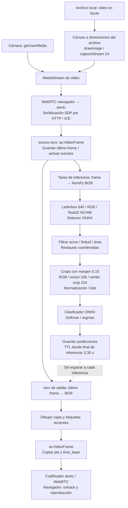

# Procesamiento de imágenes en tiempo real de Polyp Detection

Revisión del código y artefactos locales realizada el 12 de noviembre de 2026. Las rutas se expresan desde la raíz del repositorio. Se distingue entre comportamiento implementado, metadatos de los ONNX locales y resultados experimentales: inspeccionar un modelo no demuestra precisión clínica ni rendimiento en AWS.

# 1. Propósito y alcance

Polyp Detection procesa video para asistencia experimental de visualización, detección de regiones y clasificación de recortes de pólipos. El usuario prepara una cámara o un archivo en el navegador; el backend recibe una pista WebRTC, ejecuta modelos ONNX en CPU y devuelve video con anotaciones. El frontend permite visualizar también la fuente original.

**El sistema es un prototipo experimental: no sustituye el juicio clínico ni constituye diagnóstico autónomo.** Las etiquetas y valores de confianza son resultados computacionales; este documento no acredita su validez clínica. Se describe la ruta en vivo implementada en `ProcedureWorkspace.svelte` y `VideoInferenceTrack`, diferenciándola del procesamiento secuencial de archivos de `backend/scripts/test_inference.py`.

# 2. Vista general del flujo de imágenes

El recorrido implementado tiene estas etapas:

1. El navegador obtiene imágenes de una cámara o reproduce un archivo local.
2. El frontend prepara la fuente: cámara mediante `getUserMedia`; archivo mediante un elemento de video, un canvas y `canvas.captureStream(24)`.
3. La fuente produce un `MediaStream` con una pista de video que se añade a `RTCPeerConnection`.
4. Oferta y respuesta SDP se intercambian por HTTP; ICE establece una ruta WebRTC, con TURN si se necesita relay.
5. FastAPI atiende la señalización. aiortc recibe y decodifica los medios; `VideoInferenceTrack._read_frames()` obtiene objetos `av.VideoFrame` de la pista entrante.
6. El backend guarda el último frame disponible. La tarea de inferencia convierte el frame elegido a un arreglo NumPy BGR mediante `to_ndarray(format="bgr24")`.
7. El detector aplica letterbox, conversión BGR→RGB, normalización y conversión al tensor de entrada. ONNX Runtime devuelve candidatos de cajas.
8. El código filtra candidatos, deshace el letterbox y convierte coordenadas al frame original.
9. El pipeline extrae recortes con margen y los prepara para clasificación: RGB, redimensionado, recorte central y normalización. Clasifica el lote y aplica softmax y argmax.
10. El pipeline devuelve predicciones y una imagen anotada. **La ruta WebRTC utiliza las predicciones, no esa imagen**: su método `recv()` toma un frame disponible y dibuja sobre él las predicciones recientes.
11. Se crea otro `av.VideoFrame`, copiando `pts` y `time_base` de ese frame de salida elegido. aiortc codifica y transporta el video por WebRTC.
12. El navegador recibe la pista en `ontrack` y reproduce el video anotado.



No hay correspondencia obligatoria de uno a uno entre frames recibidos, inferidos y devueltos: son tres ritmos distintos.

# 3. Captura y transmisión de video

## Fuente cámara y fuente archivo

La función `preview()` de `frontend/src/lib/components/ProcedureWorkspace.svelte` prepara ambas alternativas:

| Aspecto | Cámara | Archivo |
| --- | --- | --- |
| Obtención | `navigator.mediaDevices.getUserMedia` | `URL.createObjectURL(selectedFile)` y reproducción en `fileVideo` |
| Resolución | `width: {ideal: 768}`, `height: {ideal: 576}`; preferencias, no dimensiones garantizadas | `canvas.width = fileVideo.videoWidth`, `canvas.height = fileVideo.videoHeight`; conserva dimensiones declaradas del video |
| Cadencia solicitada | `frameRate: {ideal: 24}` | `canvas.captureStream(24)`; no implica leer todos los frames del archivo ni mantener 24 FPS efectivos |
| Actualización | La pista de cámara produce frames | `requestAnimationFrame` dibuja `fileVideo` en el canvas mediante `drawImage` |
| Audio | `audio: false` | Video silenciado; la captura del canvas genera video, no se añade pista de audio |
| Reproducción | Vista local desde `MediaStream` | `fileVideo.loop = true`; reproducción local en bucle |
| Validaciones | Disponibilidad de `getUserMedia`; si hay cámara elegida, `deviceId: {exact: selectedCameraId}` | Archivo seleccionado, metadatos antes de 10 s, dimensiones no nulas, contexto 2D y soporte de `captureStream` |

La resolución de cámara se muestra desde `track.getSettings()`. No se usa un canvas para la cámara. En archivo, el canvas no hace letterbox ni aplica la normalización de los modelos; solo dibuja el video en sus dimensiones. `requestAnimationFrame`, decodificación del archivo y captura del canvas tienen sus propios ritmos y pueden repetir u omitir imágenes respecto al archivo original. El archivo no se sube por una API de carga: se transmite la pista capturada. La captura de cámara exige permisos y un contexto seguro: el propio componente señala localhost o HTTPS.

## Señalización, ICE y media

`startAssistance()` consulta primero `GET <apiUrl>/webrtc/ice-servers`, crea el peer con los servidores recibidos y añade las pistas locales. Genera la oferta, llama `setLocalDescription()` y espera recolección ICE completa, con timeout de 10 s. Después envía JSON `{sdp, type}` por `POST <apiUrl>/webrtc/offer`; el establecimiento tiene un límite frontend de 60 s. `PUBLIC_API_URL` se importa desde `$env/static/public`, por lo que depende del build; el fallback es `http://localhost:8000`.

FastAPI recibe la oferta en `/webrtc/offer`; en staging Caddy transforma `/api/webrtc/offer` en esa ruta. El backend prepara el pipeline, configura un transceptor `video/sendrecv`, aplica la oferta, asocia la pista procesada y devuelve SDP de respuesta tras recolección ICE. Hay una espera explícita de hasta 15 s para `_wait_for_ice()` después de `setLocalDescription()`; no debe interpretarse como límite total de toda la función de señalización. El navegador aplica la respuesta con `setRemoteDescription()`.

ICE busca un par de candidatos utilizable; STUN ayuda a comprobar conectividad y TURN aporta retransmisión. El backend y el navegador reciben identidades TURN efímeras distintas. Sin URL o secreto TURN, el código devuelve una lista ICE vacía. La topología staging utiliza backend privado y Coturn público; su conectividad no equivale al caso local. No hay endpoint de trickle ICE ni señalización WebSocket implementados en este flujo: los candidatos reunidos se intercambian en SDP.

La **señalización** usa HTTP y JSON. En staging Caddy está configurado en HTTP 80 sin TLS. La **media** se transmite por WebRTC, con negociación DTLS y medios SRTP; no viaja en las respuestas HTTP de la API. El transporte concreto lo selecciona ICE; TURN admite clientes TCP/UDP 3478 y relay UDP 49160–49200 en la configuración revisada. No debe confundirse TCP hacia TURN con señalización HTTP ni con un relay TCP de media.

## Códec, bitrate y tiempo del frame

El backend lee `WEBRTC_VIDEO_CODEC`, predeterminado `H264`, y solo acepta `H264` o `VP8`. Filtra las capacidades de aiortc y fija `setCodecPreferences()` **antes** de aplicar la oferta. El frontend no fija manualmente el códec ni reescribe SDP. El códec efectivamente usado se comprueba con los diagnósticos del codificador, no con el primer nombre que aparezca en SDP; incluso hay un mensaje de asociación de pista que contiene literalmente “H264” aunque la variable permita VP8.

`WEBRTC_H264_INITIAL_BITRATE` tiene valor predeterminado `2500000` bits/s. Para H.264 modifica `aiortc.codecs.h264.DEFAULT_BITRATE` antes de crear los codificadores. No fuerza tasa constante ni desactiva adaptación. La versión local y el lock son aiortc `1.15.0`; su módulo H.264 define límites de `500000` y `3000000` bits/s y un valor de biblioteca de `1000000` antes de que la aplicación lo reemplace. Son detalles comprobados en la dependencia local, no una medición de la tasa enviada ni una garantía para versiones futuras.

`VideoInferenceTrack.recv()` copia `output.pts = frame.pts` y `output.time_base = frame.time_base`. `pts` identifica la posición temporal y `time_base` la unidad en que se expresa; ambos provienen del frame elegido para salida, **no del que originó las predicciones**. En la dependencia local, `H264Encoder.encode()` convierte esa referencia a la base temporal de video para el timestamp RTP. Conservarla evita inventar una nueva cadencia, pero no sincroniza cajas con su frame de origen ni elimina pérdidas, saltos o latencia.

# 4. Gestión de frames en tiempo real

`VideoInferenceTrack` hereda de `MediaStreamTrack` y declara `kind = "video"`. Al construirse crea dos tareas, `_read_frames()` y `_run_inference()`, y se registra en `active_tracks`. aiortc solicita los frames salientes mediante `recv()`.

| Parte | Funcionamiento |
| --- | --- |
| Lectura | Espera `await self.source.recv()`, reemplaza `latest_frame`, incrementa `latest_frame_id` y contador RX, actualiza dimensiones y activa `frame_event` e `inference_event` |
| Almacenamiento | Un único campo de último frame; esta clase no tiene una cola FIFO de frames ni procesa obligatoriamente todos los recibidos |
| Eventos | `asyncio.Event` notifica disponibilidad; varias llegadas pueden quedar representadas por un mismo evento activo, no por un contador de trabajos pendientes |
| Inferencia | Al activarse, limpia el evento y toma una referencia a `latest_frame` y a su ID. Convierte a BGR y espera el lock compartido antes de ejecutar el pipeline en un hilo |
| Salida | Espera `frame_event`, toma el frame más reciente disponible, lo convierte a BGR, dibuja predicciones vigentes y devuelve otro `av.VideoFrame` |

Procesar el “último frame” evita acumular, en esta clase, una lista de imágenes que se volverían progresivamente antiguas. Cuando llegan varias mientras ONNX trabaja, el siguiente ciclo toma la más reciente disponible en ese momento y omite las intermedias para inferencia. Esto reduce una fuente de latencia acumulativa; no prueba ausencia de buffers en navegador, transporte o bibliotecas.

Hay una precisión importante con varias sesiones: la tarea toma el frame **antes** de adquirir `pipeline_lock`. Si espera a otro trabajo, la imagen elegida también envejece durante esa espera; no vuelve a seleccionar `latest_frame` al entrar al lock. `prediction_source_frame_id` registra el ID usado, pero no se emplea para alinear ni rechazar las cajas de salida por diferencia de ID.

La inferencia y la transmisión están separadas. `asyncio.to_thread(get_pipeline().process_frame, image)` ejecuta el pipeline síncrono fuera del event loop; un `asyncio.Lock` global serializa las inferencias y la carga inicial del pipeline en ese proceso. `recv()` no espera a que termine ONNX. Sin embargo, conversiones BGR y dibujo de salida permanecen en el flujo asíncrono; ejecutar ONNX en un hilo tampoco crea capacidad CPU adicional ni garantiza ausencia total de bloqueos o contención.

Si la inferencia falla, aumenta `inference_errors`, vacía las predicciones, reinicia su instante de actualización, registra la excepción y espera 0,2 s antes de continuar. Si termina la pista o falla la lectura, `_read_frames()` llama a `stop()` en su bloque `finally`.

Al pausar asistencia en frontend se aborta la petición pendiente y se cierra el peer; la fuente local continúa. Finalizar o destruir el espacio de trabajo además detiene pistas, cancela `requestAnimationFrame`, limpia videos y revoca la URL de archivo. En backend se hace limpieza al evento `ended` de video, estados de conexión `failed`/`closed`, errores de establecimiento y cierre de FastAPI. Se cancelan tareas y métricas, se cierra el peer y se retiran referencias. El estado `disconnected` muestra aviso y cambia a original en frontend; no es una condición explícita de limpieza inmediata en backend. Una pérdida de red puede tardar en detectarse. Cancelar la tarea asíncrona no demuestra interrupción inmediata de una llamada nativa ONNX ya ejecutándose en el hilo. El pipeline compartido permanece cargado para reutilizarlo.

## Implicación visual importante

Una predicción se calcula sobre un frame anterior, mientras la salida continúa avanzando. Si el endoscopio, el objeto o la escena se mueven, una caja puede aparecer desplazada respecto a la imagen actual. El código dibuja las últimas predicciones durante **0,35 segundos desde que terminó la inferencia**, no desde que se capturó su frame. Por ello, la antigüedad total también incluye captura/transporte, espera del lock e inferencia; el TTL no limita toda esa antigüedad a 350 ms.

No se implementan tracking, flujo óptico, compensación de movimiento ni sincronización por ID de frame entre predicción y salida. La caducidad limita cuánto se reutilizan resultados desde su actualización, pero **no resuelve clínicamente el desfase ni garantiza sincronización perfecta**.

# 5. Preprocesamiento

En las tablas, H y W son alto y ancho del frame; N es el número de recortes válidos. El preprocesamiento se realiza en Python antes de llamar a ONNX Runtime.

| Campo | Detector | Clasificador |
| --- | --- | --- |
| Componente | `PolypDetector` | `PolypClassifier` |
| Archivo y función responsable | `backend/app/inference/detector.py`: `predict()`, `_preprocess()` | `backend/app/inference/classifier.py`: `_preprocess()`, `predict()`; recorte en `pipeline.py::_crop_with_padding()` |
| Entrada original | `np.ndarray` BGR HWC, `[H,W,3]`, `uint8` | Lista de recortes BGR HWC `uint8` del frame original |
| Conversión de color | OpenCV `COLOR_BGR2RGB`, después de letterbox | OpenCV `COLOR_BGR2RGB` y `PIL.Image.fromarray` |
| Redimensionamiento | `r = min(640/H, 640/W)`; nuevo ancho `round(W*r)`, alto `round(H*r)`; `cv2.INTER_LINEAR` | Lado corto a 236; lado largo `int(236 * lado_largo / lado_corto)`; `Image.Resampling.BILINEAR` |
| Normalización | Convertir a `float32` y dividir entre `255.0` | Convertir a `float32`, dividir entre `255.0` y aplicar `(x - mean) / std` por canal RGB |
| Media / desviación | No aplica estandarización adicional en `_preprocess()` | `mean=[0.485,0.456,0.406]`, `std=[0.229,0.224,0.225]` |
| Orden de canales | HWC→CHW con `transpose(2,0,1)` y eje de lote; NCHW | HWC→CHW; `np.stack(..., axis=0)` forma NCHW |
| Tipo final | `np.float32`, contiguo | `np.float32`, contiguo por recorte; lote NumPy |
| Dimensiones | `[1,3,640,640]` | Recorte `[3,224,224]`; lote `[N,3,224,224]` |
| Padding / crop | Letterbox con borde constante BGR `(114,114,114)`; no recorta la imagen | Primero crop de caja más margen 0,15 por lado, limitado a bordes. Tras resize, crop central `224×224`; no letterbox |
| Reparto de borde | `dw=640-nuevo_ancho`, `dh=640-nuevo_alto`; izquierda/arriba `round(d/2-0.1)`, derecha/abajo `round(d/2+0.1)` | Coordenadas del crop central: `left=(ancho-224)//2`, `top=(alto-224)//2` |
| Aspect ratio | Escalado uniforme y relleno para cuadrado, con redondeo de dimensiones | Conserva proporción al redimensionar y luego elimina bordes con el crop central; no estira directamente a cuadrado |
| Validación de entrada | Exige NumPy, 3 dimensiones, 3 canales, `uint8`, alto/ancho no nulos | Mismas validaciones por crop. Lista vacía devuelve `[]` sin inferencia; pipeline omite recortes con `crop.size == 0` |
| Validación del modelo al cargar | Una entrada y salida; forma de entrada exactamente `[1,3,640,640]` | Una entrada y salida; dimensiones tras el lote `[3,224,224]`, última dimensión de salida igual a 2 |

Ejemplo conceptual de letterbox: la escala uniforme cambia el tamaño sin deformar deliberadamente la imagen; el padding completa el cuadrado. La inversión de coordenadas debe restar ese padding y dividir por la escala. En clasificación se prioriza un recorte central cuadrado después del resize; parte del contexto del recorte puede quedar fuera. Estas operaciones son las del código, no evidencia de que sean óptimas clínicamente.

## Metadatos comprobados de los modelos locales

Se cargaron ambos archivos con `onnxruntime.InferenceSession(..., providers=['CPUExecutionProvider'])` y se consultaron entradas, salidas y metadatos. No se ejecutó inferencia para obtener métricas ni se modificaron los archivos.

| Artefacto | Tamaño | Entrada ONNX | Salida ONNX | Evidencia de identificación |
| --- | --- | --- | --- | --- |
| `models/detector.onnx` | 38 167 232 bytes | `images`, `tensor(float)`, `[1,3,640,640]` | `output0`, `tensor(float)`, `[1,300,6]` | Productor `pytorch`; metadatos describen `Ultralytics YOLO26s`, tarea `detect`, head `Detect`, `end2end=True`, `names={0: 'polyp'}` |
| `models/classifier.onnx` | 111 371 189 bytes | `images`, `tensor(float)`, `['batch',3,224,224]` | `logits`, `tensor(float)`, `['batch',2]` | Productor `pytorch`; sin descripción ni metadatos personalizados. `batch` es dimensión simbólica |

Huellas SHA-256 para identificar exclusivamente los archivos inspeccionados:

```text
detector.onnx   a84effe99b2b6c052c7bbbf524dc9b34e0bda27cb606b9aa6926bc106043f4e9
classifier.onnx 73db86030b0a732ddccd2b9b3cf2152a6860f8fac9ee98933b080bc0fc87b2cf
```

Los metadatos del detector declaran exportación con `nms=False`, `dynamic=False`, `simplify=True` y `opset=17`. Son declaraciones del exportador, no una enumeración auditada de operadores. **No verificado en el repositorio durante esta revisión:** estructura completa del grafo, operadores internos de filtrado y correspondencia de la normalización con el entrenamiento. Para certificarlos habría que inspeccionar el grafo de `models/*.onnx` y el código/configuración de entrenamiento y exportación que produjo esos archivos. Los nombres y formas sí se leyeron del artefacto.

# 6. Detección y clasificación

## Carga y rutas

`backend/app/config.py` define `MODEL_DIR` con `POLYP_MODEL_DIR` o, si no está definida o está vacía, `<raíz del repositorio>/models`. Detector y clasificador añaden `detector.onnx` y `classifier.onnx`. En Docker se define `POLYP_MODEL_DIR=/models`; Compose monta `./models:/models:ro`. En staging Ansible sincroniza los dos archivos desde S3 a `/opt/polyp/models` y monta ese directorio como `/models:ro`. El Dockerfile no incorpora los modelos a la imagen.

`get_pipeline()` crea perezosamente una instancia global por proceso de `PolypInferencePipeline(confidence_threshold=0.25, crop_padding=0.15)`. La primera oferta provoca carga en un hilo bajo el lock; las siguientes reutilizan sesiones. Cada wrapper exige que exista el archivo y crea `ort.InferenceSession`, usando `providers or ['CPUExecutionProvider']`. No se configura GPU en el flujo actual. `/health` no carga ni valida modelos.

El código identifica el detector como YOLO26s y sus metadatos locales respaldan ese nombre. El clasificador se describe en su docstring como ConvNeXt-Tiny, pero su ONNX no incluye esa identificación: **la arquitectura exacta del clasificador no queda certificada por sus metadatos**. No se deduce una familia únicamente de tamaño o forma de tensores.

## Detección válida y coordenadas

El detector llama `session.run()` con el tensor preprocesado. Python espera salida con tres dimensiones, lote 1 y seis valores por candidato: `[x1,y1,x2,y2,score,class_id]`; el artefacto local ofrece 300 candidatos. No se aplica una decodificación de anchors o de distancias en Python: el contrato ya entrega esquinas en el espacio de entrada `640×640`.

Cada candidato debe tener todos sus valores finitos y `score >= confidence_threshold`, actualmente `0.25`. El umbral se valida entre 0 y 1 al construir el detector. El código no exige que el `class_id` sea 0 ni limita explícitamente el score a `[0,1]`; no debe añadirse esa validación a la descripción.

La transformación de regreso es:

```text
x_original = (x_modelo - pad_left) / r
y_original = (y_modelo - pad_top) / r
```

Se aplica a ambas esquinas. Después usa `round()` y limita x a `[0,W]`, y a `[0,H]`. Descarta cajas con `x2 <= x1` o `y2 <= y1`; almacena confianza como `float` y clase como `int`. No hay NMS, umbral IoU ni filtrado por solapamiento en el postprocesamiento Python. El metadato `nms=False` no basta para afirmar que el grafo carece de cualquier selección interna; no se auditó ese detalle del grafo.

## Crop, clasificación y confianza

Para caja de ancho `bw=x2-x1` y alto `bh=y2-y1`, `_crop_with_padding()` calcula `pad_x=round(bw*0.15)` y `pad_y=round(bh*0.15)`, expande cada lado y limita las coordenadas a la imagen. Extrae `frame[y1:y2,x1:x2].copy()`. Es contexto tomado de la imagen original, no relleno artificial. El pipeline rechaza padding negativo y omite recortes vacíos.

Los recortes válidos se clasifican en un lote. ONNX produce logits; se exige forma `(N,2)` y valores finitos. Python aplica softmax estable: resta el máximo de cada fila, exponencia y divide por la suma. La clase es `np.argmax(probs)`; su confianza es la probabilidad de esa clase. El mapeo del código es `0 → adenoma`, `1 → hiperplasico`. Se conservan también ambas probabilidades. No hay umbral mínimo de clasificación ni calibración implementada en ese paso. La confianza softmax no equivale a precisión clínica comprobada.

El pipeline exige tantas clasificaciones como detecciones con crop válido y las empareja en el mismo orden. Distingue confianza del detector y confianza del clasificador: se presentan separadas, no se multiplican.

## Etiquetas visibles

La ruta en vivo dibuja `cls.label.upper()` y usa el formato:

```text
ADENOMA <confianza_clasificación con 2 decimales> | DET <score_detector con 2 decimales>
HIPERPLASICO <confianza_clasificación con 2 decimales> | DET <score_detector con 2 decimales>
```

Son plantillas, no predicciones de una prueba. Los colores BGR del video en vivo son naranja `(0,165,255)` para `adenoma` y verde `(0,220,80)` para la otra etiqueta. El ID de detección `polyp` no se convierte por sí mismo en subtipo: el subtipo visible lo decide el clasificador.

# 7. Tratamiento visual y salida

En `VideoInferenceTrack._annotate()` se calcula la edad con reloj monotónico. Si supera `PREDICTION_TTL_SECONDS=0.35` o no hay predicciones, se devuelve la imagen sin cajas. No encontrar detecciones genera una lista vacía y elimina las cajas anteriores al actualizar el resultado; mientras una nueva inferencia está pendiente pueden seguir dibujándose resultados previos que aún no caducaron.

Las esquinas se limitan nuevamente, esta vez a `[0,W-1]` y `[0,H-1]`, y se omiten cajas sin área. OpenCV dibuja rectángulos de grosor 2. Calcula tamaño de texto con `FONT_HERSHEY_SIMPLEX`, escala `0.45` y grosor 1; dibuja un fondo relleno del color de la clase, limita su posición a la imagen y escribe texto blanco con `LINE_AA`. No se aplica un filtro visual especial a la escena en este método.

Hay **dos rutas de dibujo** que no deben confundirse:

| Ruta | Imagen utilizada | Diferencias comprobadas |
| --- | --- | --- |
| `pipeline.process_frame()` | Copia del mismo frame inferido, devuelta como `result.frame` | Verde `(0,200,0)`, escala de texto `0.5`; añade la marca `MVP EXPERIMENTAL - NO USO CLINICO` |
| `VideoInferenceTrack.recv()` | Frame disponible de salida, anotado con `result.predictions` recientes | Verde `(0,220,80)`, escala `0.45`; `_annotate()` no dibuja esa marca de agua |

Por ello, que `process_frame()` genere una marca de agua **no significa que la pista WebRTC actual la transmita**. El script offline escribe `result.frame`, mientras la ruta en vivo lo descarta y vuelve a dibujar cajas desde las predicciones.

`recv()` convierte la imagen anotada con `av.VideoFrame.from_ndarray(image, format='bgr24')`, copia tiempos y dimensiones, incrementa TX y devuelve el frame al emisor aiortc. No redimensiona explícitamente la salida a `640×640`: esa resolución pertenece solo a la entrada del detector. aiortc se encarga del códec, paquetización y transporte; el navegador asigna la pista recibida a `remoteVideo.srcObject` y la reproduce.

Calidad y FPS pueden variar por captura, decodificación del archivo, canvas, resolución, compresión, adaptación de bitrate, CPU, dibujo/conversiones, red y relay. El objetivo de bitrate es inicial; no asegura calidad fija, y conservar timestamps no asegura entregar todos los frames originales. Tampoco una salida fluida implica inferencia nueva en cada imagen.

# 8. Métricas y rendimiento

`_report_session_metrics()` emite logs por `uvicorn.error` aproximadamente cada `METRICS_INTERVAL_SECONDS=5.0`. Las tasas se calculan como diferencia de contadores dividida entre tiempo monotónico transcurrido. La primera muestra usa contadores previos cero, por lo que puede incluir trabajo anterior al inicio de esa ventana de reporte. No se obtuvieron resultados numéricos de una sesión real en esta revisión.

| Métrica | Qué mide | Dónde se registra | Cómo interpretarla | Limitación |
| --- | --- | --- | --- | --- |
| RX FPS | Incremento de `received` por segundo: frames leídos de la pista entrante | `webrtc.py::_report_session_metrics`, log `WEBRTC PIPELINE` | Cadencia observada por el lector backend | No es necesariamente FPS del sensor ni contabiliza pérdidas anteriores a `source.recv()` |
| TX FPS | Incremento de `sent` por segundo: frames devueltos por `recv()` | Mismo log | Cadencia que el backend entrega al emisor | No demuestra frames decodificados o visibles en navegador |
| IA FPS | Incremento de `inferred` por segundo: ciclos de inferencia terminados con éxito | Mismo log | Frecuencia de actualización de predicciones | No cuenta todos los frames recibidos ni los intentos fallidos |
| `ONNX=... ms` | Último tiempo medido desde antes de esperar el lock hasta terminar `process_frame` en el hilo | `last_inference_ms`, mismo log | Coste observado de esa operación de pipeline | Incluye espera del lock, planificación y pipeline completo, con pre/postprocesado y dibujo; excluye conversión inicial BGR. No es tiempo puro de `session.run()` ni media del intervalo |
| `detecciones` | Número de predicciones del último ciclo exitoso | `last_detection_count`, mismo log | Regiones detectadas y clasificadas en ese resultado | Puede describir un resultado ya caducado; un error vacía predicciones pero no reinicia este contador |
| `errores` | Acumulado de excepciones en la tarea de inferencia | `inference_errors`, mismo log y cierre de pista | Detecta fallos del procesamiento | No agrupa todos los posibles errores de red/lectura/codificación |
| `entrada`, `salida` | Últimas dimensiones de frames leídos y devueltos | Mismo log | Dimensiones del video manejado por la pista | No son las dimensiones internas de los tensores ONNX |
| RX/TX/IA de cierre | Totales de lectura, salida e inferencias exitosas | `stop()`, log `Pista detenida` | Resumen de actividad de esa pista | No incluye duración ni mide exactitud |
| Codificador real / objetivo / contexto | Clase de encoder, `target_bitrate`, nombre y bitrate del contexto si existen | Log `WEBRTC CODIFICADOR REAL` | Diagnóstico de la instancia de encoder realmente creada | Accede a atributo privado de aiortc; puede figurar pendiente o `N/D`; no mide por sí solo tráfico real |
| Bytes, paquetes y bitrate de salida | Contadores de `outbound-rtp`; diferencia de bytes × 8 / tiempo / 1000 | Log `WEBRTC ENCODER` mediante `pc.getStats()` | Tasa aproximada en kbit/s y actividad de envío | Primera diferencia sin referencia es `N/D`; datos de códec pueden faltar; no es latencia de extremo a extremo ni recepción confirmada |
| `detection_ms` | Duración de `detector.predict()` | `pipeline.py::process_frame`, `InferenceMetrics` | Detección incluyendo pre/postprocesado Python | No se registra desglosada en el log WebRTC; disponible en el resultado y script offline |
| `classification_ms` | Duración de `classifier.predict(crops)` | Mismo resultado | Preprocesado de crops, inferencia y clasificación | No incluye la extracción previa de recortes |
| `total_ms` | Duración completa de `process_frame()` | Mismo resultado | Incluye detección, crops, clasificación y dibujo de la copia con marca de agua | Excluye red, espera previa del lock, codificación y presentación |

RX, TX e IA responden a preguntas distintas: cuántas imágenes llegan, cuántas se entregan para enviar y cuántas se analizan. IA puede ser menor que RX y TX por diseño. Su relación no constituye una métrica de sensibilidad, especificidad o precisión diagnóstica.

## Instancia CPU y alcance de las pruebas

Terraform configura `backend_instance_type = "c7i.large"`. Frente a una máquina pequeña de propósito general como `t3.micro`, la elección de una familia optimizada para cómputo es coherente con sostener inferencia y codificación CPU. AWS describe C7i como orientada a cargas intensivas de cómputo y codificación de video; T3 utiliza rendimiento base y créditos de CPU. Eso permite explicar por qué se espera mayor estabilidad para una carga sostenida al evitar depender de ráfagas/créditos de T3. Es una expectativa técnica, **no una mejora medida en este repositorio**, ni implica que toda instancia pequeña sea peor. Fuentes de esa distinción de familias: [AWS C7i y cómputo optimizado](https://aws.amazon.com/ec2/instance-types/compute-optimized/), [AWS T3](https://aws.amazon.com/ec2/instance-types/t3/).

No se dispone aquí de benchmark comparativo ni de evidencia de CPU/memoria de la EC2 actualmente desplegada. No se deduce una cifra de FPS o latencia a partir del nombre de instancia. La contención del lock, el número de recortes por frame y la codificación pueden seguir siendo cuellos de botella.

Las pruebas existentes revisadas tienen estos alcances:

- `backend/tests/test_turn.py`: credenciales HMAC, expiración, respuesta ICE, ausencia de TURN e identidades independientes; no carga ONNX ni prueba precisión.
- `frontend/src/lib/webrtc/ice.spec.ts`: validación de configuración ICE y solicitudes simuladas sin caché; no prueba media real.
- `frontend/tests/integration/navigation.mjs`: cámara falsa, endpoint de oferta interceptado y peer de loopback en navegador; comprueba interfaz y ciclo de vida, no inferencia ONNX.
- `backend/scripts/test_inference.py`: herramienta manual secuencial con OpenCV para leer video, procesar frames, escribir MP4 y, opcionalmente, CSV con predicciones/tiempos. No usa la planificación de último frame ni el transporte WebRTC. Su FPS de procesamiento y los FPS con que escribe el archivo son conceptos distintos; puede tardar más que la duración original. El CSV añade filas por predicción, por lo que un frame sin predicciones no genera una fila de detección.

No se ejecutó el script de escritura de videos ni se presenta su salida como resultado experimental. Las carpetas `backend/tests/unit/`, `backend/tests/integration/` y `tests/e2e/` contienen archivos `.gitkeep`, sin una batería de evaluación de imágenes allí. Revisar estos tests no equivale a ejecutarlos; para esta tarea documental se verificó carga y metadatos de ambos modelos.

# 9. Parámetros actuales y dónde cambiarlos

La tabla identifica dónde están definidos; **no recomienda cambios clínicos**. Cualquier modificación que afecte resultados, calidad o temporización requiere validación experimental separada. Las constantes escritas en funciones no se convierten automáticamente en variables de entorno.

| Nombre / parámetro | Valor predeterminado o actual | Propósito | Archivo / lugar |
| --- | --- | --- | --- |
| `POLYP_MODEL_DIR` / `MODEL_DIR` | Entorno o `<raíz>/models`; Docker define `/models` | Localización de los dos artefactos | `backend/app/config.py`, `backend/Dockerfile` |
| `confidence_threshold` | `0.25`, pasado explícitamente por `get_pipeline()` | Score mínimo del detector; acepta igualdad | `backend/app/webrtc.py`, `backend/app/inference/detector.py`, `pipeline.py` |
| `--conf` | `0.25` | Umbral solo para el script offline | `backend/scripts/test_inference.py` |
| `crop_padding` | `0.15` | Margen por lado como proporción de ancho/alto de caja | `backend/app/webrtc.py::get_pipeline`, `backend/app/inference/pipeline.py` |
| `providers` | `['CPUExecutionProvider']` si no se pasa lista efectiva | Proveedor ONNX | `backend/app/inference/detector.py`, `classifier.py` |
| `input_size` detector | `640` | Letterbox y entrada `[1,3,640,640]` | `backend/app/inference/detector.py` |
| Color de padding | `(114,114,114)` BGR | Relleno letterbox | `detector.py::_preprocess` |
| Resize / crop clasificador | Lado corto `236`; centro `224×224` | Preparación espacial del crop | `classifier.py::_preprocess` |
| `IMAGENET_MEAN`, `IMAGENET_STD` | `[0.485,0.456,0.406]`, `[0.229,0.224,0.225]` | Estandarización RGB | `backend/app/inference/classifier.py` |
| `CLASS_NAMES` | `('adenoma','hiperplasico')` | Índices de salida del clasificador | `backend/app/inference/classifier.py` |
| `PREDICTION_TTL_SECONDS` | `0.35` | Caducidad desde final de inferencia | `backend/app/webrtc.py` |
| `WEBRTC_VIDEO_CODEC` / `PREFERRED_VIDEO_CODEC` | `H264`; alternativa permitida `VP8` | Preferencia del transceptor de video | `backend/app/webrtc.py` |
| `WEBRTC_H264_INITIAL_BITRATE` / `H264_INITIAL_BITRATE` | `2500000` bits/s | Objetivo inicial H.264; no tasa constante | `backend/app/webrtc.py` |
| `METRICS_INTERVAL_SECONDS` | `5.0` | Intervalo solicitado de reporte | `backend/app/webrtc.py` |
| Espera tras error de inferencia | `0.2` s | Pausa de reintento | `webrtc.py::_run_inference` |
| Cámara: ancho/alto/FPS ideales | `768`, `576`, `24`; `audio:false` | Solicitud de captura, negociable por navegador | `frontend/src/lib/components/ProcedureWorkspace.svelte::preview` |
| Archivo: dimensiones/FPS de canvas | Dimensiones de `fileVideo`; `captureStream(24)` | Pista sintética del archivo local | Mismo componente, `preview()` |
| `PUBLIC_API_URL` | Fallback del componente `http://localhost:8000`; build staging requiere origen del proxy más `/api` | Base de señalización y consulta ICE | Mismo componente; `frontend/Dockerfile` |
| Timeouts frontend | Metadatos archivo 10 s, recolección ICE 10 s, establecimiento 60 s | Límites de preparación/conexión | `ProcedureWorkspace.svelte` |
| Espera ICE backend | 15 s para `_wait_for_ice` tras descripción local | Recolección antes de responder | `backend/app/webrtc.py::offer` |
| `TURN_URL`, `TURN_SHARED_SECRET` | Vacíos | Activación y credenciales del servidor TURN | `backend/app/config.py`, `backend/app/turn.py` |
| `TURN_CREDENTIAL_TTL_SECONDS` | `3600`, debe ser positivo | Vigencia de identidad TURN; sin renovación en sesión | Mismos archivos |
| `CORS_ALLOWED_ORIGINS` | Desarrollo: `http://localhost:5173,http://127.0.0.1:5173`; despliegue lo configura | Orígenes permitidos de navegador, no transformación de imágenes | `backend/app/config.py` |
| `backend_instance_type` | `c7i.large` | Recurso de cómputo configurado; no parámetro del modelo | `infra/terraform/environments/staging/terraform.tfvars` |

No hay variable de entorno para umbral IoU/NMS o umbral de clase final en la ruta actual. Cambiar dimensiones o normalizaciones requiere comprobar compatibilidad con los artefactos; no basta con alterar una constante.

# 10. Limitaciones y consideraciones para tesis

- **Latencia acumulada:** captura, compresión, red, relay, decodificación, espera del lock, inferencia, codificación y presentación añaden demora. Los tiempos del pipeline no miden todo ese recorrido.
- **Tasas independientes:** inferencia no necesariamente trabaja a la tasa del video; el almacenamiento de último frame omite imágenes intermedias. No es procesamiento exhaustivo de cada frame ni un sistema de tiempo real con plazos garantizados.
- **Desfase de cajas:** resultados anteriores se dibujan sobre imágenes posteriores durante el TTL. No existe seguimiento de objetos o compensación de movimiento y no debe afirmarse que la caja siempre corresponde exactamente al objeto visible.
- **Dependencia de fuente y calidad:** resolución, iluminación, contenido, compresión y captura de cámara/archivo cambian los datos que recibe el modelo. Su impacto cuantitativo en este sistema no se midió en esta revisión; necesita evaluación controlada.
- **CPU y concurrencia:** la configuración actual usa CPU. Detección, clasificación por lote y codificación compiten por recursos; las inferencias de las pistas comparten lock y pipeline dentro de cada proceso. No hay benchmark que determine concurrencia o FPS garantizados.
- **Exportación y entrenamiento:** las formas y metadatos locales no certifican dataset, particiones, calidad de etiquetas, calibración ni correspondencia con los modelos almacenados en S3. Una ruta de dataset en metadatos del detector es una declaración de procedencia, no una auditoría del entrenamiento.
- **Evaluación cuantitativa separada:** reportar desempeño de tesis exige un protocolo y datos de referencia adecuados, métricas definidas y mediciones repetibles. Los logs de FPS y confianza no demuestran desempeño clínico. No se verificaron sensibilidad, especificidad, precisión, recall, mAP o resultados clínicos.
- **Pruebas de transporte frente a inferencia:** los tests simulados no prueban procesamiento ONNX con video real; la carga correcta de un modelo tampoco prueba que sus predicciones sean correctas. `/health` solo prueba respuesta HTTP.
- **HTTP público:** la configuración staging carece de TLS en Caddy; esto limita cámara fuera de localhost y no protege la señalización ni las credenciales entregadas por HTTP. El cifrado de media WebRTC no corrige esa limitación de la página y API.
- **Prototipo experimental:** el sistema no implementa diagnóstico autónomo ni reemplaza evaluación del profesional. La ausencia de cajas no demuestra ausencia de pólipos.

# 11. Archivos clave

| Propósito | Ruta | Función principal |
| --- | --- | --- |
| Captura, archivo y visualización | `frontend/src/lib/components/ProcedureWorkspace.svelte` | `preview`, `startAssistance`, `waitForIce`, `pauseAssistance`, `releaseSource`, `finish` |
| Consulta y validación ICE | `frontend/src/lib/webrtc/ice.ts` | `fetchIceServers`, `parseIceServers` |
| Montaje del espacio de trabajo | `frontend/src/routes/+layout.svelte` | Monta `ProcedureWorkspace` para preparación y sesión en vivo |
| Señalización y tareas de imagen | `backend/app/webrtc.py` | `offer`, `get_pipeline`, `VideoInferenceTrack`, `_report_session_metrics`, `close_peer_connections` |
| API y cierre de servicio | `backend/app/main.py` | Router WebRTC, `/health`, lifespan |
| Configuración | `backend/app/config.py` | `MODEL_DIR`, CORS y variables TURN |
| Identidades TURN | `backend/app/turn.py` | `get_ice_servers`, `generate_turn_credentials` |
| Detección | `backend/app/inference/detector.py` | `PolypDetector._preprocess`, `predict` |
| Crop y coordinación | `backend/app/inference/pipeline.py` | `PolypInferencePipeline.process_frame`, `_crop_with_padding`, dibujo offline y métricas |
| Clasificación | `backend/app/inference/classifier.py` | `PolypClassifier._preprocess`, `_softmax`, `predict` |
| Artefactos locales | `models/detector.onnx`, `models/classifier.onnx` | Contratos de tensores y metadatos inspeccionados |
| Herramienta de video offline | `backend/scripts/test_inference.py` | `main`: recorrido secuencial, MP4 y CSV opcional |
| Tests de credenciales/ICE backend | `backend/tests/test_turn.py` | `TurnTests`; no inferencia ONNX |
| Tests de consulta ICE frontend | `frontend/src/lib/webrtc/ice.spec.ts` | Casos de configuración, fetch y errores simulados |
| Prueba de interfaz y transporte simulado | `frontend/tests/integration/navigation.mjs` | Cámara falsa, peer loopback y cierre de recursos |
| Contenedor backend | `backend/Dockerfile` | Python 3.12, dependencias bloqueadas, ruta `/models`, Uvicorn 8000 |
| Dependencias backend | `backend/pyproject.toml`, `backend/uv.lock` | Requisitos y versiones bloqueadas; aiortc 1.15.0 / ONNX Runtime 1.31.0 |
| Contenedor frontend y uso local | `frontend/Dockerfile`, `docker-compose.yml` | Build de URL pública y montaje local de modelos |
| Modelos en staging | `infra/ansible/roles/backend/tasks/main.yml`, `infra/ansible/roles/common/files/polyp_container.py` | Descarga S3 y montaje de `/opt/polyp/models` como `/models:ro` |
| Transporte de staging | `infra/ansible/roles/proxy/templates/Caddyfile.j2`, `infra/ansible/roles/common/files/turn_config.py`, `infra/terraform/environments/staging/security_groups.tf` | HTTP/API, Coturn y puertos configurados |
| Instancia CPU staging | `infra/terraform/environments/staging/terraform.tfvars` | Tipo backend `c7i.large` |

# 12. Guion para exposición

“El recorrido comienza en el navegador. Si elegimos cámara, pedimos una resolución y una tasa de captura preferidas. Si elegimos un archivo, lo reproducimos y dibujamos sus imágenes en un canvas, que genera una pista de video.

El navegador negocia WebRTC con FastAPI enviando una oferta SDP por HTTP. Después de establecer la ruta, aiortc recibe el video y entrega frames al backend.

Cada frame elegido para inferencia se convierte a una imagen BGR. Para el detector conservamos la proporción, rellenamos hasta 640 por 640, pasamos a RGB y normalizamos. El modelo devuelve cajas y scores. Filtramos candidatos y transformamos las coordenadas a la imagen original.

Luego extraemos cada región con un margen, la redimensionamos, recortamos su centro a 224 por 224 y la normalizamos para el clasificador. Este produce dos valores; softmax y argmax permiten asignar la etiqueta y su confianza.

Para mantener el video en movimiento, inferencia y salida trabajan separadas. Se analiza el último frame disponible y se dibujan resultados recientes sobre imágenes posteriores. Por eso una caja puede tener desfase: no hay seguimiento de objetos ni sincronización perfecta.

Finalmente se conservan los tiempos del frame de salida, aiortc lo codifica y el navegador muestra el video anotado. Es asistencia experimental, no diagnóstico autónomo ni sustituto del juicio clínico.”

**Datos no verificados:** arquitectura exacta del clasificador más allá de su identificación en el código; inventario completo de operadores y filtrado interno del grafo ONNX; correspondencia del preprocesamiento con entrenamiento; datos y protocolo de entrenamiento/evaluación; calibración y métricas de exactitud clínica; equivalencia de artefactos locales con S3/EC2; configuración efectiva y códec negociado de una sesión desplegada; ruta ICE real; resolución/FPS reales de cámara, FPS de salida/inferencia, bitrate real y latencia extremo a extremo; mejora medida de `c7i.large` frente a otra instancia. Se verificaron carga, contratos y metadatos de los dos ONNX locales, sin ejecutar una evaluación de predicciones ni un benchmark. Para lo restante se requieren inspección del grafo/exportación, registros de entrenamiento, comparación de hashes de artefactos y experimentos instrumentados en el entorno objetivo.
